<p align="center">
  
</p>

<p align="center">
  A free <a href="https://claude.com/claude-code">Claude Code</a> mod that saves, syncs and shares your team's work, in plain words.
</p>

<p align="center">
  <a href="LICENSE"></a>
  <a href="https://claude.com/claude-code"></a>
  <a href=".claude-plugin/plugin.json"></a>
  <a href="#ai-use"></a>
</p>

<p align="center">
  
</p>

<p align="center">
  <a href="#get-started"><b>Get started</b></a> · <a href="#how-it-works">How it works</a> · <a href="#teams">Teams</a> · <a href="#settings">Settings</a> · <a href="#good-to-know">Good to know</a>
</p>

<br>

People try ideas in **experiments**, and their work saves by itself. When something is final, they choose to share it. Nobody needs to know what a branch, commit or merge is.

## Get started

**1. Install it** inside Claude Code:

```
/plugin marketplace add Belikely-United/marketplace
/plugin install easyversioning@belikely-united
```

**2. Turn it on** in your project. Each person does this once per project:

```
/easyversioning on
```

**3. Work as usual.** Your work saves by itself, and Claude asks before anything is shared.

You need:

- A recent Claude Code. This was built on and tested with version 2.1.317. Version 2.1.215 is too old to run it. Mods are an early-access feature that may change between releases.
- The [GitHub command line tool](https://cli.github.com), signed in with `gh auth login`. Saving and syncing work without it, but sharing doesn't.
- A project with a GitHub remote.

> [!WARNING]
> It's off until you turn it on, because it saves to GitHub for you. In a project with lots of unfinished changes, everything safe gets saved to an experiment on GitHub at the next session start or task.

<details>
<summary><b>Other ways to install</b></summary>
<br>

From a shell:

```bash
claude plugin marketplace add Belikely-United/marketplace
```

```bash
claude plugin install easyversioning@belikely-united
```

In the desktop app: click **+** next to the prompt box, then **Plugins**, **Add marketplace** with `Belikely-United/marketplace`, then **Add plugin**.

EasyVersioning is listed in the [Belikely United marketplace](https://github.com/belikely-united/marketplace).

</details>

<details>
<summary><b>Turn it off, or check where things stand</b></summary>
<br>

```
/easyversioning off
/easyversioning status
```

</details>

## How it works

Talk to Claude as usual. EasyVersioning handles the rest.

| You say | What happens |
|---|---|
| "Change the pricing page" | Claude starts an experiment. It won't affect anyone. |
| *(nothing)* | Work saves to GitHub after each task. |
| "Go back to this morning" | Claude lists earlier versions and goes back. Nothing is lost. |
| "Show me Alex's experiment" | It opens on your computer. |
| "This is final" | Claude shows a plain summary and asks before sharing. |
| "Undo what I shared" | It's removed for everyone and comes back as an experiment. |

### The status line

It always says one of three things:

- **✓ All safe:** everything is saved and shared.
- **● Saved, not shared:** the work is safe on GitHub, but only you are using it.
- **! Needs you:** a decision is waiting.

### What it does by itself

- **Sync:** brings in what teammates shared, at session start and every 5 minutes while Claude Code is open and idle.
- **Save:** commits and pushes after each task, to your own experiment.
- **Rescue:** moves work off the shared version, or off an already-merged branch, into an experiment. Commits that were never pushed are moved too.
- **Protect:** never saves `.env` files, private keys, known token formats or files over 50 MB, and tells you what it left out.
- **Remind:** at session start, lists anything left behind: unsaved work, tucked-away changes, other working copies, unfinished experiments and work on another computer.
- **Fix clashes:** when two people change the same thing, it checks first without touching any files. To fix it, a helper combines both sides where it can, and asks a person when a real choice is needed.

## Teams

Teams are optional. Someone with no team shares straight with everyone, even if others in the project have a team.

```
Company version (default branch)
   ├── Checkout team version (team/checkout)
   │     ├── Alex's experiment
   │     └── Sam's experiment
   └── Maya's experiment (no team)
```

To start one, say "Start a Checkout team with Alex and Sam". Sharing goes up one step at a time, and updates come down automatically. A team's work reaches the company as one package.

## Settings

A project needs no settings, because the defaults live inside the mod. A `.easyversioning.json` file appears only when something custom is needed, and it holds only what differs:

```json
{
  "teams": { "Checkout": { "people": ["alex", "sam"] } },
  "companyShare": "review",
  "goesLive": true,
  "check": "npm ci && npm test"
}
```

| Setting | Default | What it does |
|---|---|---|
| `teams` | none | Teams and their GitHub usernames |
| `companyShare` | `"anyone"` | `"review"` leaves work waiting for approval on GitHub |
| `goesLive` | not set | `true` adds "Customers will see this" to the summary |
| `check` | none | A command that must pass in a clean copy before updates and shares |

Each person's own status, such as which projects are turned on, stays on their computer and is never shared.

> [!CAUTION]
> `check` runs on every team member's computer. It's a shell command taken from the shared version, so only use this mod on projects where you trust everyone who can change that version.

## AI use

The mod's own AI work uses Haiku 5.5 only, with no fallback to a bigger model. It's used for three things: naming experiments, writing share summaries and fixing clashes. Normal chat uses whichever model each person selected. Saving, syncing and sharing are plain Git steps and use no AI.

## Good to know

- It only runs while Claude Code is open. Edits made with it closed are picked up at the next session.
- Everyone on the team needs Claude Code with this mod.
- Save messages come from what you typed, and experiments live on GitHub. They aren't secret: anyone with access to the repository can read them.
- Secret detection covers known key formats only. It can't catch everything.
- Undo works for experiments, but not yet for a whole team version shared with everyone.
- If nobody opens a project, its team version can't update.
- Without a `check`, clashes are still caught, but nothing proves the combined result works. Claude tests it as far as it can before sharing and says what it couldn't check.

## For developers

The Git logic is in [`hooks/core.ts`](hooks/core.ts), and the Claude Code wiring is in [`hooks/register.ts`](hooks/register.ts).

Run the tests:

```bash
bun tests/real-git.check.ts
```

They run every scenario on real repositories in a temp folder. A local repository stands in for GitHub, and a small script stands in for `gh`.

Try the mod from a local folder:

```bash
claude --plugin-dir /path/to/EasyVersioning
```

## License

[MIT](LICENSE). Free to use, change and share, forever.

<p align="center">
  <sub>Made by <a href="https://github.com/belikely-united">Belikely United LLP</a></sub>
</p>
